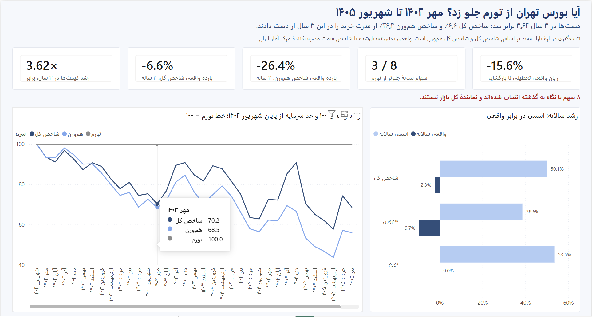

# Did the Tehran Stock Exchange beat inflation? (Mehr 1402 – Shahrivar 1405)

> **خلاصه:** از مهر ۱۴۰۲ تا شهریور ۱۴۰۵ قیمت‌ها ۳٫۶۲ برابر شد (شاخص قیمت مصرف‌کنندهٔ
> مرکز آمار). شاخص کل بورس تهران در این ۳ سال ۶٫۶٪ و شاخص هم‌وزن
> ۲۶٫۴٪ از قدرت خرید را از دست دادند (تجمعی، واقعی). فقط ۳ سهم از
> ۸ سهم نمونه از تورم جلو زدند. تعطیلی بازار از اسفند ۱۴۰۴ تا اردیبهشت ۱۴۰۵ تا بازگشایی
> ۱۵٫۶٪ زیان واقعی داشت، و اوراق دولتی هم با فرض تورم سال گذشته بازده واقعی
> منفی دارند. بورس از تورم عقب ماند، ولی از نگه‌داشتن ریال نقد بسیار بهتر بود.

**Did the Tehran Stock Exchange beat inflation, Mehr 1402 – Shahrivar 1405? No: the overall index
lost 6.6% in real terms while prices rose ×3.62.**

## Dashboard



Power BI dashboard (Persian), 4 pages. The project is in [`dashboard/`](dashboard/); a PDF export is
[`dashboard/dashboard.pdf`](dashboard/dashboard.pdf).

1. [Overview: the market against inflation](reports/figures/dashboard_1_overview.png) (above)
2. [Dispersion: 8 sample stocks, not the market](reports/figures/dashboard_2_dispersion.png)
3. [Market closure and the "safe" asset](reports/figures/dashboard_3_closure.png)
4. [Entry timing: rolling 12-month real return and correlation](reports/figures/dashboard_4_timing.png)

## Key findings

Period: 36 monthly returns, 1402-07 to 1405-06 (end of Shahrivar 1402 = 100). "Real" means
deflated by the Statistical Centre of Iran CPI.

1. **The market lost to inflation, but beat cash by a wide margin.** Prices rose ×3.62
   (cumulative, 3 years; 53.5% per year). The overall index lost 6.6%
   in real terms (cumulative, 3 years; -2.3% per year), and the
   equal-weight index lost 26.4% (cumulative, 3 years; -9.7%
   per year). Rial cash at 0% lost 72% of its purchasing power (cumulative, 3 years).
   *Implication:* idle rial cash is the costliest place to hold money; a broad index nearly kept
   its value, at 37% real volatility per year.
2. **Single stocks are bets, not inflation hedges.** 3 of 8 stocks beat inflation
   (Fameli +147%, Shepna +47%, Shasta +16%; real,
   cumulative, 3 years). Real CAGR ranged from -21.8% per year
   (Foolad) to +35.2% per year
   (Fameli). The hindsight-selected equal-weight portfolio of all 8 made
   +2.2% real (cumulative, 3 years), +0.7% per year.
   *Implication:* the spread between stocks dwarfs the gap between the market and inflation, so
   protection needs diversification, not a favourite ticker.
3. **All of the market's real gain came in the last 12 months.** The overall index returned
   -24.7%, -16.6% and +48.7%
   real per year in the three 12-month blocks. The rank correlation of the 8 stocks between
   consecutive years was only 0.26 and 0.29. *Implication:* beating inflation with
   equities needed a multi-year horizon and two losing years; last year's winner was a weak guide.
4. **Liquidity risk is real.** During the 50-trading-day market closure
   (1404-12-09 to 1405-02-28) prices kept rising: from the last close (1404-12-06) to the
   first close after it (1405-02-29) the overall index changed +0.1%
   nominal while CPI, pro-rated to those dates, rose 18.6%, a real loss of
   15.6% (cumulative over the closure; -17.0%
   with whole CPI months). Twenty trading days later the index was +37.3%
   nominal and +9.7% real from the pre-closure close. *Implication:*
   listed equities can be locked for months; keep the operating runway in instruments you can withdraw.
5. **The "safe" asset is negative in real terms too.** If inflation stays at last year's level,
   today's government bond yield implies a real return of about -19%
   per year (-26% per year against point-to-point inflation). The
   median yield to maturity of government Murabaha bonds (اراد, 103 issues) was
   40.4% per year on 1405-07-22; trailing inflation was 73.6%
   per year (12-month average) and 89.8% point to point.
   *Implication:* fixed rial income only slows the loss; size rial holdings to near-term rial costs.

Full analysis with tables and charts: [`notebooks/01_analysis.ipynb`](notebooks/01_analysis.ipynb).

## Data

| Source | What | Notes |
|---|---|---|
| TSETMC via [`algotik-tse`](https://pypi.org/project/algotik-tse/) 1.8.0 | Daily prices of 8 stocks (adjusted and unadjusted), the overall index, the equal-weight index and 7 sector indices | Adjusted official closing prices (قیمت پایانی), back-adjusted for capital increases and dividends. Downloaded 2026-10-13 (Gregorian), see [`data/raw/metadata.json`](data/raw/metadata.json). |
| Statistical Centre of Iran ([amar.org.ir](https://amar.org.ir/prices)) | Monthly CPI, all households, whole country, base 1400 = 100 | 1402-06 to 1405-06 (37 months). CPI 1402-06 = 201.7, CPI 1405-06 = 729.8. Only the Statistical Centre series is used, never Central Bank (CBI) figures. |
| Iran Fara Bourse, [ifb.ir/ytm.aspx](https://ifb.ir/ytm.aspx) | Yield to maturity of government Murabaha bonds (اراد) | Snapshot of 1405-07-22: median of 103 issues traded in the previous 30 days. Treasury bills (اخزا) are not on that page. |

- **Period:** Mehr 1402 to Shahrivar 1405 (1402-07 to 1405-06): 36 monthly returns. Prices start
  in 1402-06 so the base month has a closing price.
- **Frequency:** daily prices, aggregated to month-end; monthly CPI.

| Series | Group | Why it is included |
|---|---|---|
| Overall index (TEDPIX) (شاخص کل) | market index | the market: conclusions about "the market" use only the two market indices |
| Equal-weight index (شاخص کل هم‌وزن) | market index | the average listed company, without size weighting |
| CPI | inflation | the benchmark that "real" is measured against |
| Foolad (فولاد) | فلزات اساسی | stock: one company for this sector |
| Fameli (فملی) | فلزات اساسی | stock: one company for this sector |
| Shepna (شپنا) | فرآورده‌های نفتی | stock: one company for this sector |
| Khodro (خودرو) | خودرو و ساخت قطعات | stock: one company for this sector |
| Vbmellat (وبملت) | بانک‌ها و موسسات اعتباری | stock: one company for this sector |
| Akhaber (اخابر) | مخابرات | stock: one company for this sector |
| Shasta (شستا) | سرمایه‌گذاری‌ها | stock: one company for this sector |
| Tipico (تیپیکو) | مواد و محصولات دارویی | stock: one company for this sector |
| 8-stock EW portfolio (hindsight) | portfolio | dispersion check only: picked after the fact, not an investable strategy |

Sector indices are in the data and the Power BI model as trend lines only. They are never compared
with the stocks, because it is not known whether TSETMC sector indices include dividends.

## Method

- **Real return:** `(1 + nominal) / (1 + inflation) − 1`, with monthly inflation `CPI_t / CPI_(t−1) − 1`.
- **Monthly panel:** last available adjusted closing price of each month (month end). In a month
  without a trade the previous price is carried forward and the month is flagged.
- **CAGR:** `(G_end / G_start)^(12 / 36) − 1` on the cumulative nominal or real growth index.
- **Volatility:** standard deviation of monthly real returns × √12 (per year).
- **Maximum drawdown:** largest peak-to-trough fall of the real cumulative index.
- **Rolling 12-month real return:** compounded real return over the 12 months ending each month.
- **Market closure:** CPI is interpolated geometrically by calendar day within each month (monthly
  CPI taken as the month-end level) to get CPI on the exact last close before and first close after
  the closure; whole-month CPI is reported as a sensitivity check.
- **Equal-weight portfolio:** average of the 8 stocks' monthly returns, rebalanced monthly.
- **Correlation:** Pearson correlation of monthly real returns.

## Data quality

The full checks are in [`reports/data_quality.md`](reports/data_quality.md); every corrected value is
logged in [`reports/corrections.md`](reports/corrections.md). `data/raw` is never modified.

- **Petroleum sector index ×0.1 days:** on 5 days (1404-03-19, 1404-03-28, 1404-04-01, 1404-04-03, 1404-04-07) TSETMC stored
  High, Low and Close at 1/10 of the surrounding days, giving fake −90% / +900% daily moves. They were
  multiplied by 10 in the processed data and flagged (`was_corrected`). This index is not used in any
  finding.
- **Equal-weight index Open/Low anomalies:** on 2 days (1404-09-19, 1404-11-12) Open and Low are 10× too
  high; Close is correct. Logged, not changed: only closing prices are used.
- **Open = 0 row:** شستا on 1402-07-17. Logged, not changed (Open is not used).
- **Suspensions:** open-market days without a trade, per stock in the analysis period:
  فولاد 78, فملی 48, شپنا 23, خودرو 77, وبملت 30, اخابر 52, شستا 11, تیپیکو 18. The longest
  single suspensions, in open-market days before trading resumed, were فولاد 51 (resumed
  1405-05-17, after the market closure), خودرو 23 (1404-05-08), اخابر 22 (1404-02-07) and فملی 18
  (1404-02-22). In a month without a trade the last price is carried forward, so the move lands in
  the month trading resumes. Months with a long suspension (5 or more open-market days), no trade,
  or a market closure are flagged in the monthly panel. فولاد is excluded from the closure
  comparison because it was not trading when the market reopened.
- **Market closure:** the overall index has 61 flat, zero-volume rows (market closed), including
  1404-12-09 to 1405-02-28. No stock traded on those days; they are flagged and never counted as
  stock suspensions.
- **Corporate actions:** adjustment events were detected from the adjusted/unadjusted price ratio,
  because TSETMC's own adjustment table misses most capital increases.
- **CPI:** all 37 months present; checked against five known values.

## Repository

| Path | Contents |
|---|---|
| `src/` | `fetch_data.py`, `fetch_cpi.py`, `fetch_bond_yields.py` (download), `data_quality.py`, `process_data.py`, `analysis.py`, `build_dashboard.py` |
| `data/raw/`, `data/external/` | downloaded data, unchanged, with `metadata.json` and logs |
| `data/processed/` | daily and monthly panels (Parquet), Power BI CSVs in `powerbi/` |
| `notebooks/01_analysis.ipynb` | analysis, figures and key findings |
| `reports/` | data quality report, corrections log, data dictionary, figures |
| `dashboard/` | Power BI project (`tse_inflation.pbip`, TMDL model, PBIR report), `measures.dax`, `BUILD_GUIDE.md` (Persian), PDF export |
| `tests/` | pytest suite: raw data, processed panels, analysis, Power BI exports and dashboard files |

## Reproduce

```
python -m venv venv && venv\Scripts\activate
pip install -r requirements.txt
python src/fetch_data.py && python src/fetch_cpi.py && python src/fetch_bond_yields.py
python src/data_quality.py && python src/process_data.py && python src/analysis.py
python -m pytest -q tests
```

The downloads reflect the sources on the day they are run; the committed `data/raw` is the dataset
used here. To open the dashboard, see [`dashboard/BUILD_GUIDE.md`](dashboard/BUILD_GUIDE.md). The
committed report files include manual fixes made in Power BI Desktop, so `src/build_dashboard.py`
would overwrite them.

## Limitations

- **Hindsight selection:** the 8 stocks were hand-picked, one per sector, after the period. They
  show dispersion across sectors, not the market, and the equal-weight portfolio of them is not an
  investable strategy.
- **Sector indices:** it is unknown whether TSETMC sector indices include dividends. They are
  therefore never compared with the stocks, whose adjusted prices do include dividends.
- **Bond comparison:** the bond yield is a forward-looking snapshot (1405-07-22), while the
  inflation it is compared with is trailing (the 12 months to 1405-06).
- **CPI is monthly:** it is an average of prices collected during each month, while stock returns
  run month end to month end. Within-month figures, such as the market closure, use CPI
  interpolated by calendar day.
- **No taxes or fees:** returns are gross of transaction costs, taxes and fund fees.
- **Rights issues:** adjusted prices treat rights issues paid in cash like bonus shares, which
  slightly overstates returns around those events.

## License

The code is released under the [MIT License](LICENSE).

Market data © TSETMC; CPI © Statistical Centre of Iran; bond yields © IFB. Data is included for reproducibility only.
